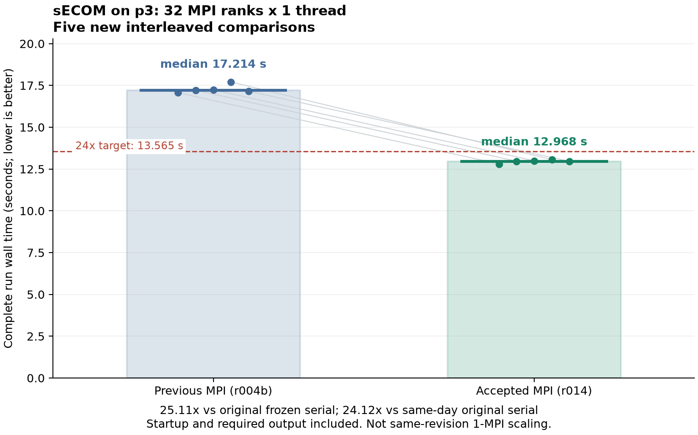

# sECOM MPI 32 核验证结果

## 追加目标：32 进程达到 24×（2026-11-19，r014）

**达标：32 MPI × 1 OpenMP，32 个物理核，五次完整运行中位数 12.9677 秒。**相对冻结原始串行 325.5553 秒为 **25.1051×**；相对当日重新运行的原始串行 312.8347 秒为 **24.1242×**。不是通过增加核数、减小算例、减少规定输出、降低精度或者延长检查间隔得到的结果。

本轮是在前版 r004b 的基础上继续优化通信和同步。代码在正式测试前冻结，五组全新运行按预注册的 AB/BA 顺序交错执行，控制组使用前版不变的二进制。所有样本都保留，pilot 和带诊断程序不进入正式统计。

| 配对 | 前版 r004b，秒 | 新版 r014，秒 | 新版／冻结原串行总加速 |
| --- | ---: | ---: | ---: |
| 1，先旧后新 | 17.065362 | 12.802254 | 25.4295× |
| 2，先新后旧 | 17.214385 | 12.967688 | 25.1051× |
| 3，先旧后新 | 17.238154 | 12.993692 | 25.0549× |
| 4，先新后旧 | 17.707078 | 13.063789 | 24.9204× |
| 5，先旧后新 | 17.153412 | 12.958454 | 25.1230× |
| 中位数 | **17.214385** | **12.967688** | **25.1051×** |

相对本批前版 MPI，中位耗时降低 **24.67%**，5/5 对均更快；相对上一轮历史中位数 16.8279 秒，降低 22.94%。冻结原串行的 24× 门槛为 13.5648 秒，五次均通过；若改用当日串行分母，则中位数通过，但最慢一次为 23.9467×，不能说该口径下五次全部超过 24×。



### 主要改了哪里

| 位置 | 前版多余成本 | 本轮实现与正确性条件 |
| --- | --- | --- |
| `baro_check.f`、`secom_mpi.f90` | 每个外部子步两次行统计收集、两次坐标归约、一次标量广播，共 5 个 collective | 正常有限值路径把极值、并列顺序和原值符号编码成整数键，一次 `MPI_MAX` 归约；不做浮点求和重排。异常、阈值和尺寸不满足时回退到两次通信或旧检查路径。保留原来的获胜行 SQRT 搜索和异常行为。48000 次检查仍全部执行。 |
| `extrnl.f`、`advave.f`、`secom_mpi.f90` | 入口每个子步 9 场双向通信；通量每次都双向发送 | 根据真实 stencil 消费方向和场的更新代次，入口第一子步 9 次单向调用、其后 5 次；FLUXVA 的三次不同生成结果分别接收北、北、南侧 ghost，绝不把不同代的 scratch 当成同一份数据。 |
| `wandd_kky.f` 私有 MPI 路径 | 湿干处理的场交换和跨进程更新重复 | 保留奇偶颜色次序和 OpenMP 同步，将跨分域更新标志在两颜色完成后统一提交；每子步 5 次场发送加 1 次标志通信。EL/D 的南侧版本必须保留给下一子步；缺失该版本的负控会失败。 |
| `mpi_boundary.f`、`extrnl.f` | 即使角点不会改到需要外发的面，也再发 UA/VA | 初始化时逐项证明角点不会修改相关外发面，所有 rank 同意才省去中段重发。任一 rank 否决则保留。实际算例证书为 `LOCALBC=T KEEP_UA=F KEEP_VA=F`。动量段只消费南侧的 CURV42D、ELF，私有路径只接收南侧 ghost，同时把本 rank 的末行发给北邻。 |

这是可移植的 MPI/OpenMP 通信策略，不依赖特定硬件指令。测试沿用既有 p3 编译配置；搬到其他机器仍应重新编译、做回归和计时，不能把当前原生编译二进制当成跨平台包。科学计算的 REAL 精度、输入、物理参数、时间步、输出时刻及内容全部保持原样。

### Profiling 是否支持这个解释

分别给旧版和最终版生成独立诊断二进制，没有把计时器放进上面的正式样本。以下是 **32 个 rank 各自累计时间的中位数**，不是可相加的墙钟分项；嵌套区间已经包含其中的 MPI 等待。

| 诊断项，秒 | r004b | r014 |
| --- | ---: | ---: |
| 时间循环 | 16.1995 | 11.5242 |
| 循环中阻塞 MPI 调用累计时间 | 7.6995 | 3.1003 |
| 每 rank 的 MPI／自身循环比例 | 47.53% | 26.90% |
| EXTRNL（含内部通信） | 7.8369 | 6.0868 |
| 湿干处理（含内部通信） | 3.1138 | 1.9276 |
| 极值／错误检查（含内部通信） | 3.9496 | 2.0383 |
| 模型初始化，不含 MPI 初始化 | 1.1340 | 1.0564 |

最终版每 rank 实际记录 48000 次健康键归约、259200 次入口发送、192000 次湿干成对场发送、48000 次湿干标志发送及 48000 次 VAF 单向发送，与 4800×10 子步的预期次数逐项相符。诊断版完整运行 13.2507 秒，六文件一致，但该时间不参与五次正式中位数。

这些数据支持“减少重复通信和同步确实有效”。阻塞调用时间也包含迟到的伙伴、调度和等待，不能把它全部称为网络传输耗时，更不能把不同 rank 的最大值相加推算总时间。中间版本 r008 的 CHECK 累计时间曾低至 1.7690 秒，最终版并非每个局部计时都更快；正式接受依据是完整事件总耗时和严格回归。

### 一致性、负控和兼容性

- 五次正式运行的全部 24 个输入 SHA 不变，32 rank 的实际亲和性都限制在 CPU 4–35；主 rank 六文件、其他 rank 两个私有日志均与当日原始串行逐字节相同。
- 最终源码另构建早期／后期诊断版，保存既定的 12 帧 × 25 个完整场及头部，全部逐字节匹配原串行。与旧版诊断不同，新快照只复制所属行到临时缓冲再收集，**不写求解器真实 ghost**，因而不会替错误的通信补数据。故意破坏真实 ghost 的对照能检出旧快照的这种掩蔽风险。
- 原生微测覆盖分块不均匀、单行 rank、MPI×OpenMP、湿干标志和 ETB 所有权、不同代通量、正负零、极值并列、正常指数边界和异常回退。漏南侧 EL、漏 VAF、发错通量代次、误跳角点重发等负控均拒绝。真正获胜位置的 signaling NaN 在新旧程序都触发 SIGFPE，没有用提前扫描引入新异常。
- 107 个生产源码文件的冻结映射 SHA 为 `46f5da3de7d5904ed20e902e1c1ba501f2ca40fa090e11c07a8d7754a6b9d1a4`。旧公开 ADVAVE、EXTRNL、WANDD 及角点计算过程经独立 Git 对照保持原计算语句；缩短 halo 只在适用的私有 MPI 路径启用。多 rank CHECK 则独立检查正常值条件后尝试整数键归约，公开 CHECK 仍先刷新自己的输入 halo，异常回退不省略。
- 当前源码干净重编译的纯串行 300 步、OpenMP 32 线程完整运行（12.2580 秒）、8 MPI×4 OpenMP 完整运行（13.3071 秒）均通过六文件检查。这是单次兼容性测试，不是新的配置性能结论；仍不能声称 32 MPI 已比纯 OpenMP 更快。

当前验收范围仍限于本报告的单节点正压开发算例，不外推三维、多节点或其他 case。人工强制独立 `ROTATE=false` 的一项微测中，既有 MPI 父版本本身就与单 rank 的 VAF 不同；新版本与 MPI 父版本一致，该历史范围缺口没有被修复或隐藏。内存仍是每 rank 的全尺寸旧数组，未宣称实现按进程数缩小内存。逐字节回归不是新增的实测物理精度验证。

### 试过但没采用的东西也保留

下面仅为开发过程的 pilot，不是独立统计验收或逐项收益分解。

| 候选 | 完整秒数 | 处理 |
| --- | ---: | --- |
| r005 九场合包 | pilot 16.7747；新旧配对约 17 秒，差别很小 | 不采用 |
| r006 双向九场合包 | 17.0827 | 不采用 |
| r007 两通信极值 | 15.9412，复测 16.0973 | 保留为回退与后续基础 |
| r008 湿干／检查代次复用 | **28.4304**，复测 15.4257 | 慢样本完整保留，缺少当时诊断，原因未确定 |
| r009 三代通量方向 | 14.8955 | 进入最终版 |
| r010 入口按代次合包 | 14.6000 | 被无需打包的实现替代 |
| r011 入口单向直接发送 | 14.0968 | 进入最终版 |
| r012 正常检查单归约 | 13.7833 | 进入最终版 |
| r013 湿干 5 次场发送 | 13.5758 | 尚未达到 24×，继续优化 |
| r014 角点证明＋动量方向＋清理 | pilot 12.8352 | 冻结后做上述五次全新验收 |

没有重跑慢样本后删除原记录；九场入口合包实验保留在 `mpi/packed/`，最终入口不启用它。湿干处理的两个同代同方向场成对发送则属于最终实现，二者不要混为一谈。

### 复核入口与证据

本轮新增 `mpi/audit_acceptance24.py`，用包外冻结的科学／早期／后期 ELF 和源码 SHA 验收五次正式样本、交错对照、输入、实际绑定、输出及帧；`mpi/plot_acceptance24.py` 从已验收数据绘图。最终 Git 树还用 `mpi/haloepochs/audit_science_git.py` 对 107 文件重新核验。证据包为工作区 `work/secom-mpi-20261119/results/evidence-v2.tar.gz`，独立验收结果保存为 `independent-audit24-final.json`，前版 v1 包不覆盖。

新包包含所有运行回执（含失败、慢样本和未接受实验）、正式六个实际输出、两组供本地直接复算的 25 场参考／候选、12 帧整帧散列及远端逐场比较、三个实际验收 ELF、源码和构建／profile 记录。其余 10 帧没有重复下载全部大场，但其整帧散列与事先锁定的原串行参考逐一独立核对。整个传输限速 500 KB/s，解包前验证 SHA、完整 MANIFEST 和路径安全。

---

## 前一轮 16× 目标的历史记录（r004b，原文保留）

2026-11-19，p3，澳门天鸽开发算例。目标是基于既有 OpenMP 版本开发 MPI／OpenMP 混合版本，先以 **32 MPI × 1 OpenMP、最多 32 个物理核**完成相对原始串行至少 16 倍加速，并通过输出检查。

## 结果和比较口径

固定科学版本 `r004b` 的 5 次完整事件均通过检查：

| 独立运行 | 完整耗时 秒 |
| --- | ---: |
| full01 | 16.6671 |
| full02 | 16.5957 |
| full03 | 16.8712 |
| full04 | 16.9948 |
| full05 | 16.8279 |

中位数 **16.8279 秒**。原始冻结串行是 **325.5553 秒**，因此总加速 **19.3461×**；用当天重新运行的原始串行 **312.8347 秒**作分母，也达到 **18.5902×**。两种口径均超过 16×，最慢的正式样本亦超过目标。没有挑选最快样本，也没有把带场输出的诊断运行纳入计时。

这些是相对**最初串行程序的总加速**，包含此前 v46 已有的等价计算优化，不是本版本相对自身 1 MPI 的纯强扩展效率。此轮没有新测本版本 1 MPI 的完整性能基线。

**MPI 版本目前不比单节点 OpenMP 更快。**兼容性检查中，当前源码的纯 OpenMP 32 线程完整运行用时 12.1893 秒；8 MPI × 4 OpenMP 用时 17.4430 秒，两者六文件也均通过。它们各只有一个完整样本，不是新的正式性能结论；但不能把 MPI 的 19.35× 描述成在现有 OpenMP 之上又加速 19.35 倍。

计时从 MPI 启动器启动前到进程结束，包含进程启动、初始化、求解和规定输出；不包含复制输入、事后 SHA 审计、编译和证据传输。所有科学运行只用 CPU 4–35，32 个不同物理核，不用其 SMT 兄弟核。每个 rank 的实际全部 OS 线程亲和性有记录；MPI 辅助线程不等于额外 OpenMP 计算线程，也不能跑到分配核之外。按用户授权与其他 ylf 作业共存，没有停止或修改其他作业。

## 一致性检查

输入仍为 372×479、KB=2 的同一网格，4800 个内部步、每步 10 个外部子步，共 48000 子步；24 个输入文件、物理配置、时间步长和输出节奏未改。固定 GNU Fortran 8.5、OpenMPI 4.1.1，沿用 v46 的严格浮点选项和 p3 编译设置，不采用 fast-math、混合精度或浮点求和重排。

- 5 次正式运行的主进程六个文件 `fort.1002`、`fort.1006`、`startup`、`gcmplt.cdf`、`gcmprt`、`heat.dat`，均与当天原串行 **SHA-256 完全相同**。非主进程只保留私有日志 `gcmprt/heat.dat`，两者也比较，而非写 32 份大型公共输出。
- 独立早期 5 帧、后期 7 帧，每帧 25 个全场和极值／坐标头逐字节一致，包含干格、湿干掩码、三层时间状态、速度、摩擦、应力、质量通量和对流项。后期覆盖 1200 步历史输出前后及事件末尾，未只比较最终水位。
- 早期帧为 `(1,1),(1,10),(17,3),(153,5),(300,10)`；后期为 `(601,2),(1199,10),(1200,10),(1201,1),(2400,7),(3600,4),(4800,10)`，括号是内部步和子步。
- 原生微测覆盖不均匀和单行分域、MPI×OpenMP、湿干跨进程写入、正负零、极值并列和异常阈值、边界快路径否决、归档历史、能量和站点。故意漏发湿干更新或 CBC 时，负控被正确检出。
- 默认非 MPI 模式不新增 MPI 库依赖。实际 serial 300 步、OpenMP 32 线程完整事件、MPI 8×4 完整事件分别通过六文件检查。默认归档路径另做了 12 组原例程对照。

与串行逐字节一致，是**此算例、这些构建和这些检查的工程回归结论**，不是新的实测物理精度评估，也不是所有时间、所有算例和所有编译器的形式证明。实际科学数据仍保留原有 REAL 精度，没有提高或放宽容差。

## 具体改动

1. `secom_mpi.f90` 与 `mpideck` 提供按全局 J 行连续分块的 MPI 运行时。`EXTRNL`、`ADVAVE`、湿干处理和极值检查只算本进程所属行；相邻行在正确的生成阶段交换，不传旧一代数据。
2. 湿干算法可能写北邻行，不能简单并行原循环。保留全局奇偶行顺序，用显式事件标志通知该行所有者置零或复制**所有者本地 ETB**；不让未更新的 ghost 覆盖真值。
3. 边界邻接关系在初始化时检查。只有 CLAMPED／LINEAR、无流量或扩散源、跨行端点仍在同一所有者等条件成立，才用邻域 halo；其他支持的情况保留保守全场同步。
4. 极值仍按原来的舍入值、并列顺序、先速度后最低水位的顺序恢复坐标。没有用改变浮点顺序的 MPI_SUM 来替换诊断。
5. `BCOND(7)`、Manning CBC、底应力 `BOTTAU`、历史 `ARCHIVE` 改为所属行计算。保留输入记录读取、时间游标和同格累计顺序；所需邻行及时交换。完整字段仅在历史写出、打印、重启动等真正需要的事件收集，不再在每个内部步末全收集 24 个场。
6. NetCDF、文本大场和重启动文件由 rank 0 写；其他 rank 仍执行必要的 COMMON 标志、网格坐标和输出计数更新。每个 rank 使用独立工作目录，避免旧程序私有临时文件相互覆盖。

在相同的带 5 帧诊断的 300 步测试中，保守原型为 34.15 秒，边界局部通信后为 10.84 秒，主进程输出后为 10.73 秒，所属行外层计算后为 2.87 秒。这些仅说明开发阶段的瓶颈变化，不能替代上面的完整事件计时。

## 适用范围和未完成部分

当前交付的是**单节点正压开发路径**，不是所有三维物理模块的完整 MPI 移植。快速外层路径要求冷启动、INTERNAL、BAROTROPIC、JTM=0、CONSTANT 水平混合、MANNINGS-N、AVERAGED 气象、无 PET、无特殊冰摩擦、CDF 输出、无化学层及空 E/V/F 站点列表，并须通过局部边界判定。其他正压支持路径使用保守同步；未移植的输运、波浪、泥沙、化学、粒子或三维路径不能冒充已支持。保护判断不修改输入。

目前每个进程仍分配全尺寸旧数组，初始化和输入读取也仍有重复；**分布式计算不等于内存已经按进程数缩小**。未做多节点验证；提供的 p3 启动脚本仅面向本机固定核集合。其他平台需重新编译及验证，不直接搬用带 p3 `-march=native` 的二进制。

`mpi/packed/` 的九字段合包只完成独立微测，**没有进入本次科学二进制**。`mpi/profile/` 是单独生成诊断 ELF 的工具，也未混入正式样本。二者不是已验收的进一步性能收益。

首版所属行外层候选 `r004outer` 在末尾快照失败：误把 BCOND 的局部 PRECTEMP 当成 COMMON 数组，旧式隐式声明使其变成标量实参。删除该无用快照后成为 `r004b`。原失败日志和运行结果保留；新增编译器符号表检查，对 46 处快照实参核对类型／尺寸，并用标量、错误 REAL 类型和非法 K 范围作负控。没有删失败样本来改善统计。

## 构建与复查

```sh
make -C source -f Makefile.portable MODE=mpi MPIFC=mpifort NF_CONFIG=nf-config
```

GNU 8 的 MPI 模式自动避开其不支持的 `-fallow-argument-mismatch`；p3 验证额外沿用 `TUNE_FLAGS="-march=native -mprefer-vector-width=256"`。非 MPI 构建用 `MODE=serial` 或 `MODE=omp`，GNU 8 需显式提供不含该新选项的严格 FFLAGS。MPI 模式本身支持 OpenMP，初始化要求 `MPI_THREAD_SERIALIZED`。不要从只参与一部分 rank 或一部分线程的分支调用 collective；具体契约见 [RUNTIME.md](RUNTIME.md)。

`mpi/run_case.py` 负责全新目录、输入 SHA、固定核、进程组超时、文件对照和运行记录；不是任意集群的通用提交器。`mpi/build_trace.py` 另建诊断程序，`mpi/check_trace.py` 比较所有保存场，`mpi/collect_evidence.py` 打包选取证据，`mpi/unpack_evidence.py` 校验 SHA／MANIFEST 并安全解包，`mpi/audit_evidence.py` 在本地独立验收，不仅仅读取远端 passed 标志。

证据目录为工作区 `work/secom-mpi-20261119/results/`。包内保留全部运行记录和失败证据、正式样本 full03 的六个实际输出、两组独立复核用的完整参考／候选场，以及源码和构建记录。其余 10 个保存时刻在 p3 全场比较并记录整帧 SHA，没有下载所有重复大场。
